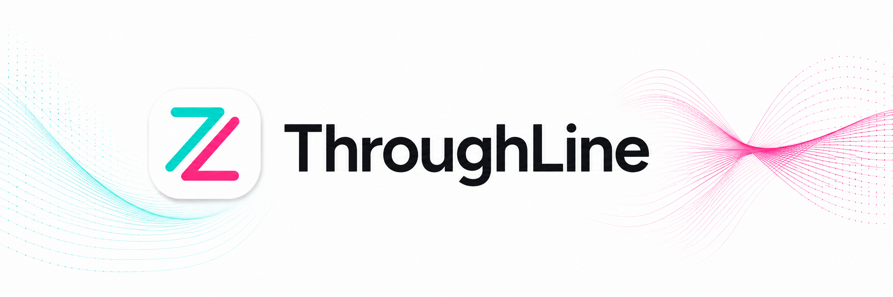
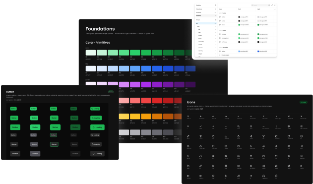

<div align="center">



# ThroughLine

### Your agentic design team

**Design screens with agents, on the design system you already use or one ThroughLine builds with you in hours, not months. Built for Claude Code, and installable into Cursor, Codex, or any AGENTS.md agent.**

[](https://radicool.studio/throughline)
[](https://www.npmjs.com/package/@radicool/throughline)
[](LICENSE)
[](https://docs.claude.com/en/docs/claude-code)
[](#install)
[](https://main--6a1ee089ae3a37b70a6e4559.chromatic.com)
[](https://www.figma.com/design/OCiZiGpsJ4ncPD8r205BjC/Throughline-Plugin-Test?node-id=0-1&t=5ERihD6fMqMuTEXD-1)

</div>

ThroughLine is a design team you run from your agent. Open a Figma file built on your team's library and it composes screens from that library. Start from nothing and it builds you a production-grade design system first, then designs with it. Already have a system that's drifted? It retrofits that too. Whichever way in, you make the high-level decisions while your agentic team powers through the production work. You stay in control of the *what*; it handles the *how*.

**No code experience required.**

## Design with what you have

Every screen you compose in Figma starts by reading the open file and telling you, in one line, which of three modes it's in and what that mode gives up.

1. **Your ThroughLine system's own file.** The strictest mode. Every colour, gap and radius is bound to a token, anything the system doesn't have is recorded as a gap, and every screen is tracked for drift. A product file that uses your system as a library is mode 2 for now, with its gaps still landing in your system's gap file.
2. **A Figma library you already use.** *New in 0.32.* No system to build first. The library comes first and the file's own components fill the gaps, and the report names every one it used. A hardcoded colour, gap, radius or padding side is allowed only where no variable holds it, and each one is listed. Ask for 20px when `spacing/space/5` is 20 and the build refuses, naming the variable.
3. **Nothing at all.** *Planned.* Screens built from frames to auto-layout standards, with an offer at the end to turn the one-off values into variables.

In both modes you can use today, a screen that needs a component that doesn't exist says so instead of drawing a lookalike.

Guides, examples and news live at **[radicool.studio/throughline](https://radicool.studio/throughline)**.

---

## What ThroughLine builds

### In Figma

1. **A robust primitive + semantic token system** — color ramps, spacing, type scale, radius, and elevation, with light/dark and multi-brand modes.
2. **Automatic generation of all text and effect styles** — every type and shadow style, derived from your tokens.
3. **A visual style sheet** of every token and style for full team transparency — synced to your tokens on demand.
4. **A full icon component system** — Lucide, Material, or your own SVGs, imported as clean, scalable components.
5. **A foundational component library** — buttons, inputs, badges, cards, and more, built as proper variant matrices bound to your tokens.

### In code

1. **A pnpm + Turborepo monorepo** on GitHub, scaffolded for you.
2. **A sync adapter** that syncs your Figma tokens and components to the code framework of your choice.
3. **Storybook** configured to house all synced components and their documentation.
4. **CI via Chromatic** for visual regression testing on every push.

### Documentation

1. **One record per component, rendered everywhere.** Usage, variants, states, dos and don'ts, accessibility notes and the tokens it uses are written once, then rendered to the Figma description, a doc card on the canvas, Storybook, and an `llms.txt` digest your AI tools can read.
2. **Docs that notice when they're stale.** `docs:check` flags any copy rendered from an older version of its record, and a Storybook page someone edited by hand.

### Checks

ThroughLine doesn't just build the system. It checks it, and the checks that guard a build stop it rather than print a warning.

1. **Contrast, in every mode.** Text-on-surface pairs are held to WCAG AA when tokens are created and again when they sync to code, so a theme that passes in light and fails in dark fails.
2. **Focus you can see.** On web frameworks, a component with no visible focus ring, or one below 3:1 against its surface, stops the Figma build.
3. **Output that matches its source.** `tokens:validate-output` checks generated CSS, Swift and Kotlin against the tokens they came from, because the stock transforms have been caught emitting wrong values that still compile.
4. **Screens that use the system.** In Figma, a detached component or a hardcoded color, gap, padding or radius where a token already has that value. In code (React and Angular), a raw color or size where a token exists, and a variant your component doesn't have.
5. **Drift.** `/throughline:drift` reports when Figma, the docs or the code have moved apart. It reports rather than blocks, apart from a broken screen or a hand-edited token file, which fail its CI script.

## Use it every day

These are the commands you'll live in. `compose-figma` and `gap-report` work on a connected library too; the rest assume a ThroughLine system. In Claude Code they're namespaced, so `/throughline:drift`. Other agents run the same skills by name.

| Command | What it does |
|---|---|
| `/throughline:start` | Set up from scratch, or pick up where you left off. |
| `/throughline:design-system-status` | A plain-language picture of what's built and what's next. |
| `/throughline:sync-figma-tokens` | Bring Figma's latest variables into code, as a pull request you review. |
| `/throughline:new-component` | One new component, end to end: Figma, tokens, code and stories. |
| `/throughline:document-component` | Write or refresh one component's docs, everywhere they appear. |
| `/throughline:check-figma` | Check what's already in Figma against the system, without changing it. |
| `/throughline:compose-figma` | Build a screen in Figma from your system, or from a connected library. |
| `/throughline:compose-code` | Build the same kind of screen in code, as one React file. |
| `/throughline:gap-report` | Everything your screens asked for that the system or library doesn't have, ranked. |
| `/throughline:drift` | What moved since you built it, and the command that fixes each thing. |

Already have screens or components in Figma? `/throughline:check-figma` checks them against the system without touching the file: it flags a component someone detached, and a colour, gap, padding or radius that's hardcoded when a token already has that value. It also runs the state, focus-ring and focus-contrast checks over the components already in your library.

Need a new screen? `/throughline:compose-figma` builds it in Figma from your own components and tokens, every value bound. If the screen needs something your system doesn't have, it says so instead of drawing a lookalike, and it runs the same check before handing the screen over. No ThroughLine system? Open a file built on a connected Figma library and it composes from that library instead, keeping its records in a `design/` folder next to your work.

Want it in code instead? `/throughline:compose-code` writes the screen as one React file in your app, using only your components and your tokens. It checks the plan before writing a line, reports any component you don't have rather than building one, and gates the file before handing it over.

Every gap either composer reports gets kept. `/throughline:gap-report` ranks what your screens asked for and didn't get by how many screens asked, and calls out the ones where people keep reaching for something you already have. You decide what to build, what's already covered, and what to drop.

Things built from the system don't stay in step with it on their own. `/throughline:drift` tells you what moved. It flags a composed screen that uses a variant someone since removed, and one whose components changed underneath it. It flags a generated token file someone edited by hand, which the next sync would quietly overwrite. With Figma open, it also tells you which variable collections changed since your last sync, so you know the sync is overdue before anyone ships the old values. And it holds each component to its doc record: the states and options a Figma component has that its docs don't, and code built before the record's variants, states or tokens last changed. The code half is a plain script, `drift:check`, installed with the documentation scripts, so you can run it in CI.

## Already have a design system? Retrofit it.

Most teams aren't starting from a blank file — they have a mature codebase with hundreds of hard-coded colors and a Figma file that's drifted from it over the years. ThroughLine treats that as a first-class path, not an afterthought, and it moves *carefully*: it never asserts what's in your files without reading them first, and it never deletes an old token until it's proven nothing still uses it.

1. **Audit before anything changes.** `design-system-audit` sizes both sides of your system — it greps your codebase to measure the real color surface and inventories your Figma file with verified, per-class reads — then tells you how big the migration actually is and how semantic your system already is.
2. **A crosswalk that guarantees nothing shifts.** `token-crosswalk-builder` maps every new token to its old Figma variable and old code value, then installs a `tokens:validate` gate that fails unless every resolved new value matches the old one (N/N). A zero-reference guard blocks removing an old token while any code still references it.
3. **A gated, reversible migration.** `retrofit-planner` walks the safe seven-phase sequence — audit → refine variables in place → rebind → sync → capture a visual baseline → retrofit the code → adopt existing docs → remove the old tokens — pausing for your confirmation between every phase, with an optional decision journal recording each call.

The payoff: your live product looks identical at every step, and you can prove it with a Chromatic baseline captured before the first change.

## See a real end-to-end system built with it



| | |
|---|---|
| 🧩 **[Sample repo](https://github.com/jrpease/throughline-sample)** | The full monorepo — tokens, 14 components, Storybook, CI |
| 📚 **[Live Storybook](https://main--6a1ee089ae3a37b70a6e4559.chromatic.com)** | Every component, all props, auto-generated docs |
| 🎨 **[Public Figma file](https://www.figma.com/design/OCiZiGpsJ4ncPD8r205BjC/Throughline-Plugin-Test?node-id=0-1&t=5ERihD6fMqMuTEXD-1)** | The design source of truth it was generated from |

Everything above was created during a single working session and synced directly from Figma to a production-ready codebase.

## Getting started

### Requirements

| | |
|---|---|
| **A supported agent** | Required — [Claude Code](https://docs.claude.com/en/docs/claude-code) (native plugin), or **Cursor**, **Codex**, or any **AGENTS.md**-aware agent via `npx @radicool/throughline@0.32.1 init`. |
| **Figma** | Required, **desktop app** (the browser version causes connection errors). **Professional plan or higher recommended** — multi-mode variables (Light/Dark, brand themes) need it. |
| **Figma access token** | Optional — only for the few Figma calls the Desktop Bridge can't make, like reading a published library. Without it, you work through the bridge alone. The setup skill walks you through it; your token stays yours and is never shared in chat. |
| **GitHub** (or similar) | Optional — only when you're ready to graduate to a real remote repo with PRs and CI. |

### What it runs on your machine

ThroughLine runs one local server. Nothing leaves your machine unless you choose it below.

- **One local MCP server.** Installing the plugin registers [`figma-console-mcp`](https://www.npmjs.com/package/figma-console-mcp), pinned to version 1.40.8, which your agent starts on your computer with `npx`. It reaches the Figma desktop app through the Desktop Bridge plugin you run in Figma. That's how ThroughLine reads and writes your file. For the Figma calls the bridge can't make, it uses a Figma access token if you give it one. Claude Code asks for the token as a plugin setting and keeps it in your system's secure credential store. It's optional. The Cursor, Codex and generic installs read it from `FIGMA_ACCESS_TOKEN` instead.
- **Files in your repo.** The skills write design-system files where you point them: token sources, the Style Dictionary build, components, stories, `design-system.json`, and the proof records in `design-system/proof/`. The helper scripts they install read and write local files and make no network calls.
- **GitHub, if you choose it.** `repository-builder` offers to create a GitHub repository and push to it, and shows you the command and waits for your yes before it runs. Once your repo is on GitHub, each token sync lands there as a pull request for you to review. Stay at a local folder or local git and nothing goes to GitHub.
- **Chromatic, if you choose it.** Setting up Chromatic adds a CI workflow that uploads your Storybook to your Chromatic project, using a `CHROMATIC_PROJECT_TOKEN` you place yourself. Skip that step and nothing goes to Chromatic.

### Install

ThroughLine is authored as a Claude Code plugin and generated into adapters for other agents. Pick your tool:

#### Claude Code

Install from this repo's plugin marketplace:

```
/plugin marketplace add jrpease/throughline
/plugin install throughline@throughline-marketplace
```

Then start with:

```
/throughline:start
```

This is the reliable entry point for building a design system — it runs environment setup first, ahead of anything else. Designing on a library your team already has? You still need Figma connected, so follow "Connect to Figma" (Step 4) in the `figma-environment-setup` skill, then run `/throughline:compose-figma` with that file open. Skip the rest of `start`: it sets up a design system, which would point ThroughLine at that product file as if it were one. (You can also just say *"let's set up my design system"*, but if you have other plugins installed that grab "let's build…" style phrases, the slash command guarantees ThroughLine takes the wheel.)

Update anytime with `/plugin marketplace update throughline-marketplace`.

#### Cursor, Codex, or a generic AGENTS.md agent

Run the installer in your project — it stamps in the skills, the reference docs, the scripts, and the Figma MCP config for your tool:

```
npx @radicool/throughline@0.32.1 init --target=cursor    # → .cursor/rules + .cursor/mcp.json
npx @radicool/throughline@0.32.1 init --target=codex      # → prompts/ + AGENTS.md index + codex-mcp.toml
npx @radicool/throughline@0.32.1 init --target=generic    # → skills/ + AGENTS.md index
```

It's safe to re-run (it merges `AGENTS.md` and `.cursor/mcp.json` non-destructively) and stages everything the skills read into `.throughline/`. Then open the `figma-environment-setup` skill/rule/prompt for your tool to begin. For Codex, add the printed `codex-mcp.toml` block to your Codex config to enable Figma access.

## Architecture

ThroughLine is more than a pile of skills — it's a small system designed to stay consistent across dozens of generation steps. Four layers work together:

**🛠 Twelve skills — the steps.** Each owns one stage of the journey, from connecting Figma to retrofitting an existing system to standing up CI. They're sequenced, and each knows its prerequisites.

**📐 The reference docs — the constitution.** Shared standards every skill obeys: Figma component rules (auto-layout-on-everything, slot contracts, naming-as-contract, a required post-build audit), the brainstorm-before-build protocol, the sync-adapter specs, the manifest schema, coding-level adaptivity, the publishing flow, and the brownfield-retrofit discipline (read-before-assert, the safe migration sequence, the crosswalk contract). This is *why* two different runs produce the same structure — the rules live in one place, not scattered per skill.

**🧭 An orchestration layer — the memory.** A `design-system.json` manifest in your project records exactly what's set up, with a versioned schema and immutability rules. Every skill reads it, tells you what it's about to do, and offers to run anything missing first. Run **`/design-system-status`** anytime for a plain-language picture of where you stand.

**🔌 An adapter layer — the bridge.** A Style Dictionary pipeline that translates your Figma variables into whatever code framework you target — and re-translates on every change. When something does slip, `/throughline:drift` says what and where.

### The skills

| Skill | What it does |
|---|---|
| **figma-environment-setup** | Create your working folder, connect Claude to Figma, scan what already exists. **Start here.** |
| **design-system-audit** | Measure an existing system *before* retrofitting — size the code-side color surface and inventory the Figma file with verified reads. The brownfield front door. |
| **token-builder** | A two-tier (primitive + semantic) token system as Figma variables, plus text/effect styles. Generative, descriptive, or import-your-own. |
| **token-sheet-builder** | A beautiful, on-brand **Foundations** page visualizing every token, live-bound to the variables. |
| **icon-system-builder** | An **Icons** page with your chosen library (Lucide, Material, or custom) as clean components — the cheap, fast way. |
| **component-builder** | Your foundational components (button, input, card, modal…) with full variant matrices, slots, and token bindings. |
| **repository-builder** | Graduate your folder into a pnpm + Turborepo monorepo — folder → local git → GitHub, one gentle step at a time. |
| **token-sync-layer** | Sync Figma variables to framework-specific code via Style Dictionary, landed as a reviewable PR. Installs `/sync-figma-tokens`. |
| **token-crosswalk-builder** | Map new tokens to their old Figma variables and old code values, and install the `tokens:validate` gate that proves no value changed during a retrofit. |
| **storybook-chromatic-builder** | Storybook, component stories, Chromatic visual testing, and Code Connect (where your Figma plan supports it). |
| **component-pipeline** | Add one new component end to end: Figma → tokens → code + stories. Installs `/new-component`. |
| **retrofit-planner** | Orchestrate a full retrofit through the safe, gated seven-phase sequence — with a human checkpoint at every phase. |

## The nitty gritty

For the technically curious — how the machine actually runs.

**The sync layer.** Figma variables are extracted to **DTCG-format** JSON (the W3C design-tokens standard), run through **Style Dictionary**, and shaped by a framework **adapter** into the exact output your stack expects — shadcn CSS variables, a Tailwind theme, MUI theme objects, Swift/Kotlin constants, or plain CSS. Because the code is *generated* from the extract, design and code can't drift: you never hand-edit outputs, you change Figma and re-run. The sync lands as a **pull request**, so every design change is reviewable, diffable, and CI-checked before it merges.

**The monorepo.** A **pnpm + Turborepo** workspace: `packages/` holds the generated tokens and the component library; `apps/` is where you build the actual product against your own design system. ThroughLine grows it in stages — plain folder → local git → GitHub remote with PRs and CI — introducing each concept only when its payoff is concrete, so you're never dropped into the deep end.

**The manifest.** `design-system.json` is the single source of truth for *state*: a versioned schema, canonical per-skill flags, an immutable record of how your project began (greenfield vs. existing repo), and a snapshot of tooling detected at setup. Skills read it to know what's done and what's safe to do next — which is how the system stays coherent across many sessions.

**Modes, within Figma's limits.** Light/Dark lives on the semantic collections; brand variants live on the primitive palette. Splitting the two axes across two collections keeps each one under Figma's 4-modes-per-collection cap on the Professional plan while still resolving correctly (`bg/default` → `{gray/50}` → the active brand's gray).

**Model routing.** ThroughLine routes work by *cognition, not guesswork* — the expensive thinking on the best model, the mechanical doing on a cheap one. Inside a skill, the deciding — a token architecture, a variant matrix, a slot contract — is planned once on the strongest tier, while the long mechanical part — placing Figma nodes, transcribing component code, running SVGR — runs on a cheap tier and self-verifies. You get the best model where it matters and a cheap one where it doesn't, without micromanaging it. The recommended mapping is **Haiku → Sonnet → Opus** for the `fast < balanced < deep` tiers, but nothing is hardcoded — the ladder resolves against whatever models your install actually has, and on hosts without subagents skills degrade cleanly to a single model. You can still steer the session yourself (`/model opus` for the heaviest authoring, back to `/model sonnet` after); nothing forces an expensive model on you.

## Who it's for

1. **Product designers** working in a team's Figma library, who want screens built from the real components rather than lookalikes.
2. **Solo designers** who spend a lot of time building and managing design systems.
3. **Agencies** consistently spinning up new design systems for clients.
4. **Design teams** constantly fighting to keep their Figma and code systems in sync.
5. **Non-designer vibe coders** who want a stronger design-system backbone on their projects.
6. **Engineers** looking to bridge their code and design ecosystems.

## Why I built it

I'm a designer who got tired of the handoff. Design systems live in two places that never quite agree — the Figma file and the codebase — and keeping them in sync is a full-time job nobody wants. ThroughLine is the tool I wished existed: it lets a designer drive the whole pipeline, learn the engineering one concept at a time, and end up with a real, shippable system instead of a pile of redlines. If you're a designer who's becoming a developer, this was built for you.

Then I noticed the system was only half the job. Nobody ships a design system. They ship the screens built with it. So ThroughLine designs now too: on the system it built you, or on whatever library your team already has.

## Show it off

Built your own system with ThroughLine? Add the badge so others can find it:

```markdown
[](https://github.com/jrpease/throughline)
```

[](https://github.com/jrpease/throughline)

## Contributing

ThroughLine is open source and contributions are welcome. Found a bug or have an idea? **[Open an issue](https://github.com/jrpease/throughline/issues)**. Want to improve a skill or reference doc? PRs are encouraged — the skills are Markdown, so they're approachable to edit.

A couple of ground rules:
- **Figma is the source of truth.** Generated code files are build artifacts — never hand-edited; change things in Figma and re-sync.
- **Secrets stay yours.** Tokens and keys are never sent through chat or committed to code.
- **The plugin validates itself.** Every PR runs CI (`.github/workflows/ci.yml`) — the full test suite plus zero-dependency structural validators that check `plugin.json`, the marketplace manifest, and every skill/command's frontmatter. Run them locally with `node --test` and `node ci/validate-plugin.mjs` / `node ci/validate-skills.mjs`.

## Roadmap

Future improvements and planned capabilities. Have a request? **[Open an issue](https://github.com/jrpease/throughline/issues)** — the roadmap is shaped by what people actually build.

- **The rest of design modes** — building on a connected library shipped in 0.32.0. Planned, in this order: a product file that uses your own ThroughLine system as a library, held to the system's rules; `/throughline:design` for whole flows (an intake, two directions on the hardest screen, every state, annotations, organized pages); building in a file with no system at all; and the same modes in code.
- **Library text styles** — Figma's plugin API won't list a library's text styles, so in a file built on a library, only the file's own text styles can be used for now.
- **More framework adapters** — broaden the Style Dictionary output targets beyond the current set.
- **Deeper Code Connect coverage** — richer Figma-to-code mappings as more plans support it.
- **Expanded component starters** — a larger foundational kit out of the box.
- **Reading component code** — `/throughline:drift` now checks Figma components against their doc records and knows when code was built against an older record. What it can't do yet is read the code itself, or compare the properties the record doesn't describe (text, toggles, icon swaps).
- **More accessibility checks** — contrast and focus rings are checked today (see [Checks](#checks)), and the code gate fails an icon-only button with no accessible name and a status badge that relies on color alone. Keyboard behaviour and wider ARIA patterns aren't checked yet, and the checks haven't caught a bug in the wild so far: the one real app they've run on gave them little to check.
- **Token fan-out to more platforms** — the DTCG token source is platform-neutral, and web targets are in daily use. Every target is **validated per build, not assumed**: `tokens:validate-output` checks generated output against its source, native Swift and Kotlin as well as web CSS, because the stock transforms have been measured emitting wrong-but-compiling values. iOS/Swift is a curated adapter whose Style Dictionary configuration ships as tested code, and Android/Kotlin uses the same configuration through the Tier 2 protocol. JavaScript theme output (MUI, a Tailwind v3 config) isn't checked yet.
- **Native component code generation** — producing a SwiftUI view or a Compose composable the way Storybook components are produced for React. This does not exist yet; it is a separate, larger effort than token fan-out, and the two were previously described as one roadmap item.

Versioning follows [Semantic Versioning](https://semver.org). The current version lives in [`.claude-plugin/plugin.json`](.claude-plugin/plugin.json); every release is recorded in [`CHANGELOG.md`](CHANGELOG.md).

## License

[MIT](LICENSE) © Jordan Pease
